<!--
For this README to appear on your GitHub profile, the repository name must be exactly:
Haritha-Sivasankaran
-->

<picture>
  <source media="(prefers-color-scheme: dark)" srcset="./assets/profile-card-dark.svg" />
  <source media="(prefers-color-scheme: light)" srcset="./assets/profile-card-light.svg" />
  
</picture>

  <a href="https://www.linkedin.com/in/haritha-sivasankaran/">
    <picture>
      <source media="(prefers-color-scheme: dark)" srcset="./assets/btn-linkedin-dark.svg" />
      <source media="(prefers-color-scheme: light)" srcset="./assets/btn-linkedin-light.svg" />
      
    </picture>
  </a>
  &nbsp;
  <a href="https://github.com/Haritha-Sivasankaran?tab=followers">
    <picture>
      <source media="(prefers-color-scheme: dark)" srcset="./assets/btn-github-dark.svg" />
      <source media="(prefers-color-scheme: light)" srcset="./assets/btn-github-light.svg" />
      
    </picture>
  </a>

