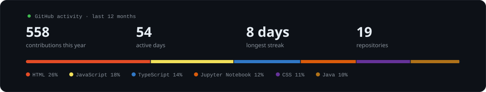

<!--
For this README to appear on your GitHub profile, the repository name must be exactly:
Haritha-Sivasankaran
-->

<picture>
  <source media="(prefers-color-scheme: dark)" srcset="./assets/header-dark.svg" />
  <source media="(prefers-color-scheme: light)" srcset="./assets/header-light.svg" />
  
</picture>

### About

I'm a Systems Engineer at TCS who enjoys owning a feature end to end: designing the API, wiring up the event pipeline, and shipping the interface people actually use.

- **Frontend:** React · Next.js · TypeScript · Tailwind CSS · Vue · Svelte
- **Backend:** Java · Spring Boot · Spring AI · Node.js · Express · REST
- **Messaging:** Apache Kafka · RabbitMQ · WebSockets
- **Data & infra:** PostgreSQL · MongoDB · Docker · GitHub Actions · Linux

### Activity

<picture>
  <source media="(prefers-color-scheme: dark)" srcset="./assets/stats-dark.svg" />
  <source media="(prefers-color-scheme: light)" srcset="./assets/stats-light.svg" />
  
</picture>

Updated automatically every 6 hours.

### Connect

