<!--
For this README to appear on your GitHub profile, the repository name must be exactly:
Haritha-Sivasankaran
-->

<picture>
  <source media="(prefers-color-scheme: dark)" srcset="./assets/header-dark.svg" />
  <source media="(prefers-color-scheme: light)" srcset="./assets/header-light.svg" />
  
</picture>

### About

I build full-stack products end to end: Spring Boot and Node services, event pipelines on Kafka and RabbitMQ, and fast, accessible React interfaces.

- **Frontend:** React, Next.js, TypeScript, Tailwind CSS, Vue, Svelte
- **Backend:** Java, Spring Boot, Spring AI, Node.js, Express, REST
- **Data & infra:** PostgreSQL, MongoDB, Docker, GitHub Actions, Linux

### Connect

[LinkedIn](https://www.linkedin.com/in/haritha-sivasankaran/) · [GitHub](https://github.com/Haritha-Sivasankaran)
